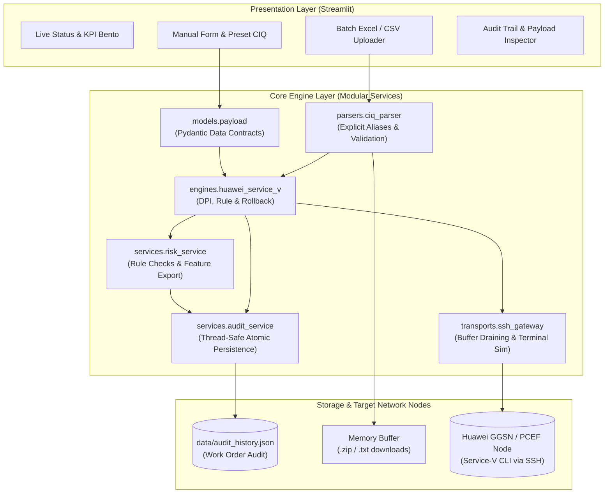

# 🏛️ RELPOOL Core Automation — System Architecture

**Document Version:** 2.3.0  
**Target Organization:** Indosat Ooredoo Hutchison (IOH)  
**Group:** Core Planning & Engineering — MCPE Core 2026  

---

## 1. High-Level Architecture Overview

RELPOOL dirancang dengan pola **Clean Layered Architecture (Domain-Driven)** untuk mengotomasi siklus hidup konfigurasi Policy and Charging Enforcement Function (PCEF) dan Policy and Charging Rules Function (PCRF UPCC) pada node Core Network Huawei.

---

## 2. Layer Definitions

### A. Presentation Layer (`ui/` & `app.py`)
* Bertanggung jawab murni untuk interaksi pengguna, visualisasi KPI, dan rendering form.
* Tidak mengandung business logic rule telco maupun SSH low-level socket handling.

### B. Domain & Rule Engine Layer (`core/engines/`)
* **`BaseRuleEngine`**: Abstraksi generic untuk mendukung arsitektur multi-vendor (Huawei, Cisco, Ericsson).
* **`HuaweiServiceVEngine`**: Menghasilkan hierarki CLI Huawei Service-V:
  $$\text{Host} \longrightarrow \text{Filter} \longrightarrow \text{Filter-Group} \longrightarrow \text{Rule} \longrightarrow \text{User Profile}$$
* Generates **rollback drafts**. Delta updates require a snapshot and emit no executable rollback. Revamp retains v1 for rollback. Live UI execution is blocked until device pre-checks and snapshot rollback are implemented.

### C. Data Ingestion & Batch Layer (`core/parsers/`)
* **Explicit Header Aliases**: Known English/Indonesian aliases are supported; ambiguous columns and missing required values are rejected. Substring guessing is disabled.
* **In-Memory ZIP Packager**: Menghasilkan arsip `.zip` dan file `.txt` gabungan langsung pada buffer RAM.

### D. Transport & Security Layer (`core/transports/`)
* **`ssh_gateway.py`**: Melakukan buffer polling adaptif untuk mencegah respon terpotong pada koneksi WAN/VPN telco.
* **`crypto.py`**: Fernet authenticated encryption with a native generated key. Encryption/decryption failures are surfaced; plaintext requires explicit opt-in. Existing passphrase-derived credentials require migration.

### E. Persistence Layer (`core/services/`)
* New UI events append under one process lock; reads refresh on every rerun. Audit errors stop the workflow. Records carry UUID event IDs, UTC timestamps, linked work orders and versioned risk features. JSON remains unsuitable for multiple worker processes; use a transactional database before scaling.
* Risk scores are deterministic review priorities, not trained model outputs. See [Reliability and ML roadmap](RELIABILITY_AND_ML_ROADMAP.md) for remaining production requirements and anomaly detection design.
* Penyimpanan Work Order audit trail dengan mekanisme **Atomic File Write** (`.tmp` ➔ `os.replace`) dan **Thread-Locking** untuk keamanan konkurensi.
